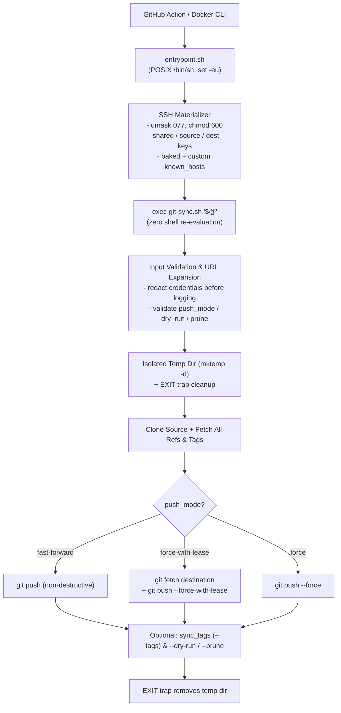

# Architecture — `homgorn/git-sync`

## Execution Flow

## Design Principles

1. **Zero external runtime dependencies beyond `git` and `openssh-client`:** Small Alpine `3.21` footprint, fast cold-start in GitHub Actions.
2. **Strict POSIX `/bin/sh`:** Works identically in BusyBox `ash` (Alpine), `dash` (Debian/Ubuntu), and Git Bash (Windows CI/dev).
3. **Defense in depth:**
   - Positional argument forwarding (`exec ... "$@"`) eliminates command injection.
   - `IdentitiesOnly=yes` prevents SSH agent/default key cross-contamination between source and destination.
   - `BatchMode=yes` guarantees non-interactive fast failure instead of hanging CI runners on passphrase prompts.
   - `redact_url()` prevents HTTPS PAT leakage in runner logs.
